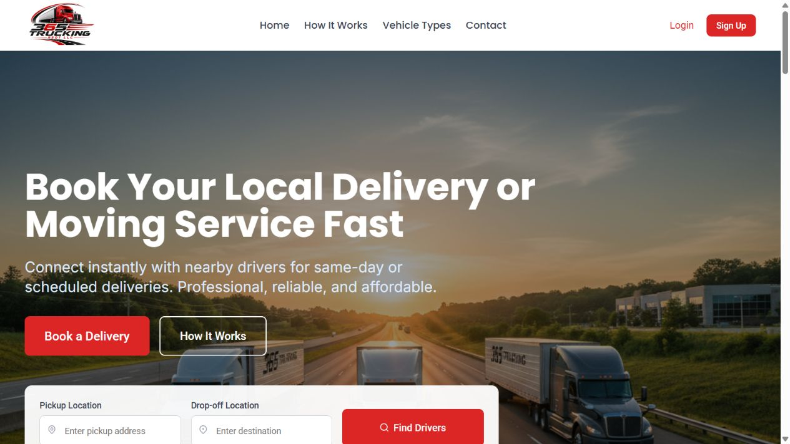
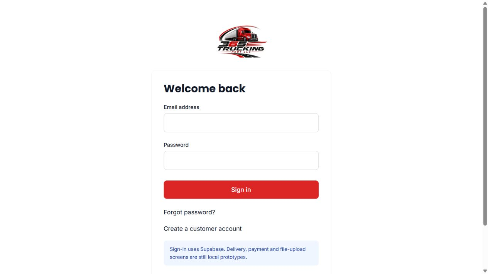
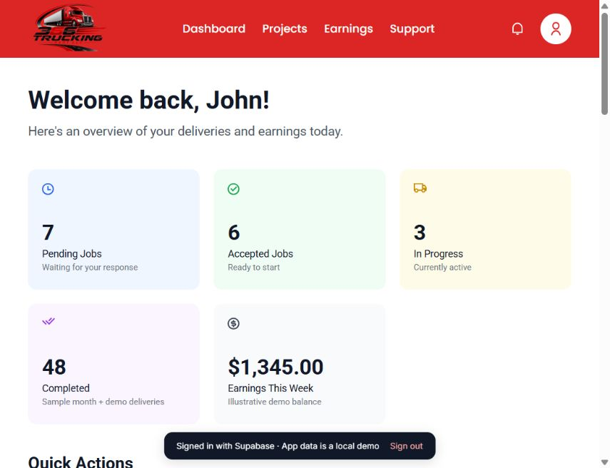

# 365 Trucking

**A three-portal delivery and moving application connecting customers, drivers, and administrators.**

[View the live app](https://365-trucking.pages.dev/) · [Explore the code](#how-it-was-built) · [Run locally](#run-locally)

365 Trucking turns a Figma-designed booking experience into a responsive web application. Customers plan a delivery, drivers manage jobs, and administrators review driver verification documents and delivery outcomes. The project combines working Supabase authentication and private document storage with interactive prototypes for dispatch and financial operations.

**Project owner:** [Lindsey Alcinay](https://github.com/Lcw900)  
**Status:** Active development / portfolio showcase. This is not yet a production dispatch or payment service.



## What the app can do

| Portal | Experience |
| --- | --- |
| Customer | Choose a vehicle, enter pickup and drop-off details, schedule service, add delivery options, review estimated pricing, and explore order history and tracking views. |
| Driver | Browse pending jobs, accept work, progress a delivery through pickup and completion, view illustrative earnings, manage profile settings, and submit verification documents. |
| Admin | Review customer, driver, delivery, and payment screens; explore account-access controls and payout/refund decision flows; review real driver verification submissions. |

The booking-to-delivery prototype carries state between portals in the same browser. Its lifecycle guards prevent invalid transitions, including changes to cancelled jobs. Financial prototypes require completion before a payout decision or a reviewed non-delivery/cancellation before a refund decision.

### Connected services versus prototypes

| Capability | Current implementation |
| --- | --- |
| Accounts | Supabase email/password signup, email confirmation, sign-in, recovery, session refresh, and sign-out. |
| Roles | Server-owned customer, driver, and admin profile roles, with portal access checks. Admin assignment is private. |
| Driver verification | Private Supabase Storage and Postgres records for license front/back, insurance, ID/passport, and background-check documents. |
| Document review | Admin approval or replacement requests, version checks, and review history; protected with database/storage policies. |
| Booking and job progression | Browser-local prototype using localStorage; not shared across devices or isolated into real operational user accounts. |
| Payouts, refunds, and account removal | Local demonstration decisions and activity history. No money moves and these controls do not remove Supabase accounts. |
| Profile photos and settings | Browser-local media/settings; avatars use IndexedDB. |
| Maps | Google Maps JavaScript API integration, lazy loaded near the viewport. Sample routes use illustrative coordinates. Live GPS, geocoding, routing, and ETA are not connected. |
| Emails and support | Auth email delivery depends on Supabase/provider configuration. Branded email HTML is included; custom SMTP, booking notifications, and live support messaging remain future work. |

Marketing statistics, reviews, sample people, jobs, and earnings in the UI are demonstration content, not verified business results. Do not use real payment details or personal documents to explore the portfolio.

## Screenshots

### Customer sign-in



### Driver dashboard



The driver screenshot shows an earlier UI iteration with sample data. Its logo treatment may differ from the latest live release. Screenshots contain no uploaded identity documents or customer records.

## How it was built

The customer and driver experiences were implemented from supplied Figma designs. The admin workspace extends the same red, navy, and white theme and typography. Development iterated through responsive layouts, initial-load and scroll transitions, shared branding, role-based navigation, and the document verification workflow. Implementation and debugging were assisted by OpenAI Codex; this repository documents the delivered behavior and its current limits.

| Layer | Technology and purpose |
| --- | --- |
| Interface | HTML, CSS, and vanilla JavaScript ES modules; responsive layouts, hash-based routes, and reusable rendering helpers. |
| Typography and assets | Poppins, Inter, and Roboto styles with supplied brand artwork and design assets. |
| Interaction | CSS transitions and IntersectionObserver-based reveal behavior, with reduced-motion handling. |
| Authentication | `@supabase/supabase-js`, bundled with esbuild; PKCE email flows and persisted sessions. |
| Database and files | Supabase Postgres, row-level security, private Storage, and database functions for document submission/review. |
| Prototype state | localStorage for delivery/admin simulations; IndexedDB for local profile media. |
| Maps | Google Maps JavaScript API. |
| Tooling | Node.js local server, syntax checks, Node's built-in test runner, and GitHub Actions. |
| Hosting | Static deployment on Cloudflare Pages, with Open Graph metadata and Apple sharing icons. |

### Engineering highlights

- **Consistent workflows across three roles:** customer bookings feed the local driver job view, with status progression reflected back in customer and admin screens.
- **Business rules outside the UI:** store modules enforce delivery progression and financial decision constraints, backed by automated tests.
- **Private document handling:** authenticated downloads, owner/admin access rules, immutable replacement paths, version checks, and recorded review events.
- **Responsive product UI:** multi-step forms, search/filter views, dashboard cards, settings screens, and accessible reduced-motion behavior.
- **Incremental service integration:** backend-connected authentication and verification are explicitly separated from local operational prototypes.

### Architecture

```text
Browser SPA (customer / driver / admin)
  ├── Supabase Auth → account session
  ├── Postgres profiles → role/status and access policies
  ├── Private Storage + document functions → submissions and reviews
  ├── localStorage / IndexedDB → prototype operations and avatars
  └── Google Maps → map presentation (optional configuration)

Cloudflare Pages serves static HTML, CSS, JavaScript, fonts, and images.
```

## Run locally

Use Node.js 22 LTS and npm.

```bash
git clone https://github.com/Lcw900/365-trucking.git
cd 365-trucking
npm ci
npm run dev
```

Open [http://127.0.0.1:5173](http://127.0.0.1:5173). The public landing page can be viewed immediately. Protected portal routes need your own configured Supabase project and the appropriate account role; there is no shared admin password or public authentication bypass.

This source copy uses placeholder service configuration. The owner's deployed project settings, deployment archives, local logs, and user uploads are not included.

### Connect your own services

1. Follow [Supabase setup](supabase/SETUP.md) to create profiles, private storage, and document review permissions in a new development project.
2. Edit `src/public-config.js` with your Supabase project URL and **publishable** browser key, then run `npm run build:auth`.
3. Add your local/deployed URLs to Supabase Auth URL configuration. Register and confirm accounts; use a trusted project-owner workflow to assign admin access.
4. Optionally set your Google Maps browser key and map ID in `dist/maps-config.js`. Restrict it to your own referrers and the required API.
5. Configure a custom email provider for reliable signup email delivery. The bundled email templates alone do not configure SMTP.

Browser configuration is public by design. Never place service-role keys, database passwords, SMTP credentials, or payment secrets in frontend files. Database and Storage policies must enforce authorization independently of the interface.

### Validation

```bash
npm run build:auth
npm run check
npm test
```

Tests cover delivery state progression, cancelled/assigned job guards, local admin decisions, and document-store rules. `tests/document-permissions.sql` is a separate transaction-based database regression script for a prepared **test** project; it is not executed by `npm test`. See [document review notes](supabase/DOCUMENTS.md) for prerequisites.

### Project structure

```text
dist/                 Static application and authored ES modules
  app.js              Customer routes and booking screens
  driver*.js          Driver views and prototype job logic
  admin*.js           Admin views and prototype decision logic
  cloud-documents.js  Supabase document workflow
  document-store.js   Document validation and transition rules
  assets/             Brand artwork, design images, icons, and fonts
src/                  Auth source and placeholder public configuration
supabase/             SQL setup, permission snapshot, and email templates
tests/                Node unit tests and separate SQL regression script
scripts/              Syntax checks and Cloudflare packaging
docs/screenshots/     Portfolio screenshots
server.mjs            Local static server
```

`dist/` contains authored application code as well as the generated auth bundle, so it is intentionally committed. Rebuild `dist/auth-client.js` after changing `src/`.

## Next milestones

- Move bookings, driver assignment, and delivery events into shared backend storage with transactional permissions.
- Connect a payment processor for customer charges, administrator-approved driver payouts, and refunds.
- Add delivery-scoped live location updates, routing, and realistic ETA calculation.
- Configure branded transactional emails and delivery notifications.
- Replace remaining sample content and browser-local account/profile management with production services.

See [deployment notes](CLOUDFLARE.md) for static hosting. The live app and this source snapshot may evolve independently.

## Design and asset credit

Customer and driver UX originated in the supplied [365 Trucking Figma design](https://www.figma.com/design/OsjTAlL1OzWdFd5bjw7BQy/365-Trucking--Copy-). Brand artwork was supplied for this project. Third-party design assets and fonts retain their respective rights; this repository does not grant additional rights to them. No open-source license has been assigned to the project.
